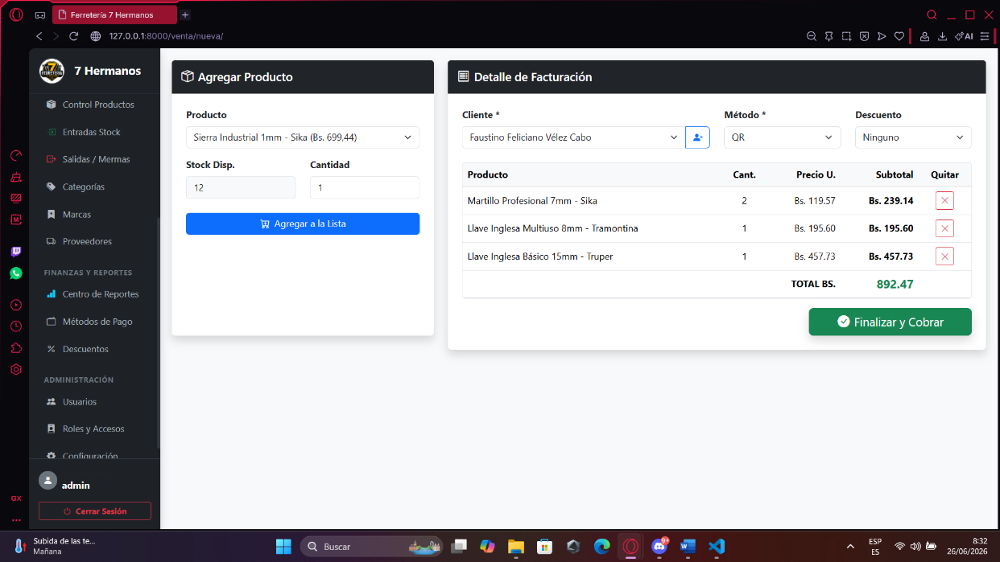
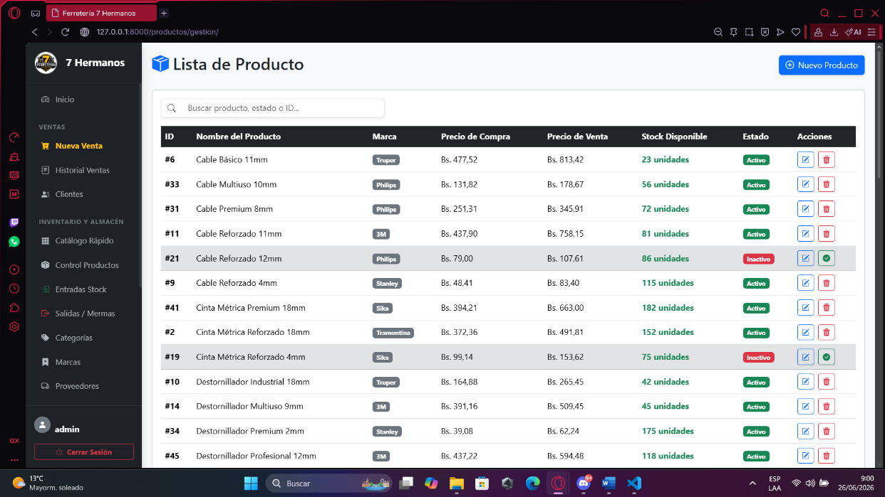
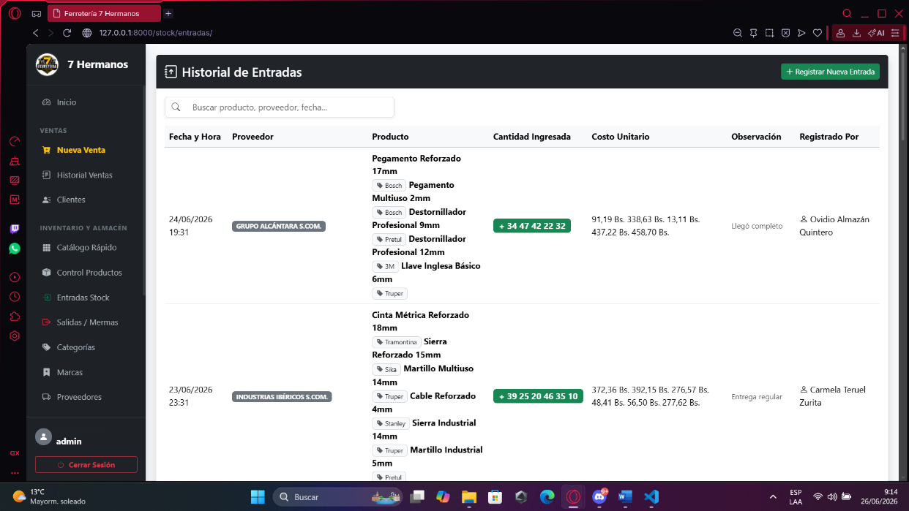
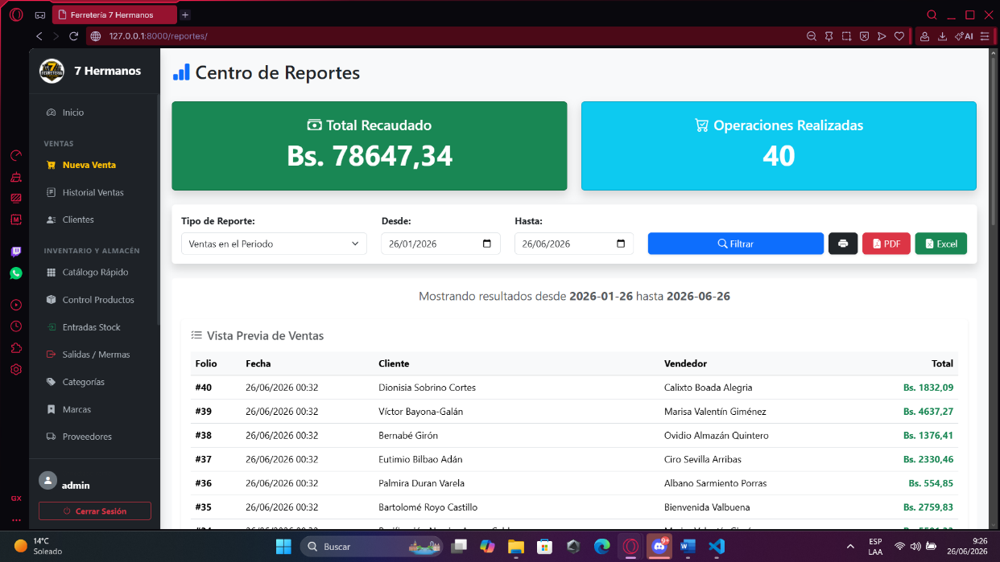
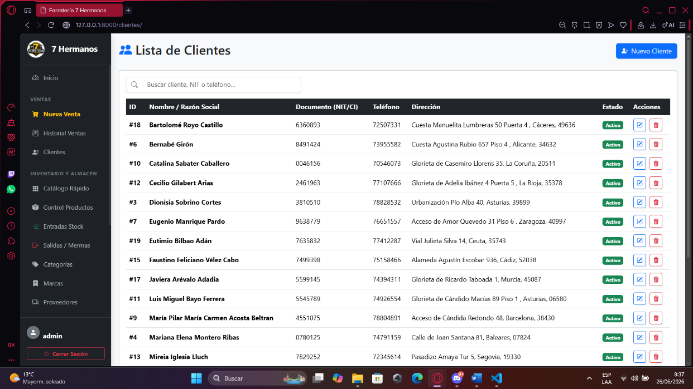
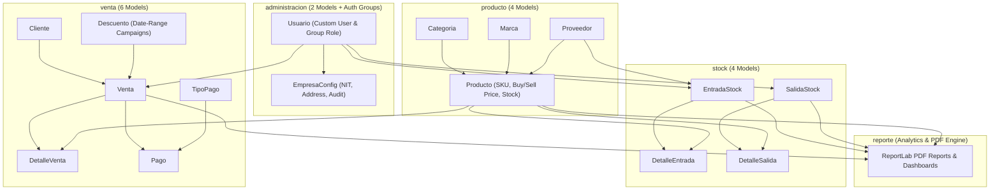

# Ferretería 7 Hermanos — Retail POS, Inventory & Stock Management System


A full-stack Point of Sale (POS), inventory control, and stock ledger web system custom-built for **Ferretería 7 Hermanos** (Santa Cruz de la Sierra, Bolivia). Developed as a Systems Engineering Capstone Project (*Proyecto de Grado — Ingeniería en Sistemas*), this platform digitizes retail hardware store operations with role-based access control, database-level integrity constraints, stock entry/exit ledgers, multi-payment invoicing, and automated PDF reporting.

---

## 📸 System Screenshots

### 1. Point of Sale (POS) — New Sale & Cart Workflow


### 2. Product Catalog & Real-Time Stock Levels


### 3. Stock Movement Ledger (Supplier Entries & Inventory Exits)


### 4. Reporting Center & PDF Document Generation


### 5. Customer Directory & Tax ID (CI/NIT) Registry


---

## 🏗️ System Architecture & Relational Data Model

The system is structured around **5 decoupled Django applications** (`administracion`, `producto`, `stock`, `venta`, `reporte`) and **16 custom relational models** backed by PostgreSQL with database-level `CheckConstraint` and case-insensitive `UniqueConstraint` rules:



### Key Implemented Features

1. **Role-Based Access Control & Company Configuration (`administracion`)**
   - Custom `Usuario` model linked to Django `Group` roles (*Administrador*, *Vendedor*, *Almacenero*) and granular module permissions injected globally via `administracion.context_processors.permisos_usuario` and `@requiere_permiso` decorators.
   - Centralized `EmpresaConfig` model storing company tax ID (`NIT`), phone, address, and last-modified user tracking (`actualizado_por`) for receipts and official PDF headers.

2. **Hardware Catalog, Brands & Suppliers (`producto`)**
   - Full CRUD for `Producto`, `Categoria`, `Marca`, and `Proveedor`.
   - Enforces PostgreSQL `CheckConstraint` validations at the database level (`precio_venta >= precio_compra`, non-negative `stock_actual` and `stock_minimo`, and case-insensitive `Lower("nombre")` uniqueness on categories and brands).

3. **Stock Entries & Exits Ledger (`stock`)**
   - **Supplier Stock Entries (`EntradaStock` & `DetalleEntrada`):** Records multi-item restock deliveries by supplier (`Proveedor`), unit purchase cost (`costo_unitario`), and responsible user, automatically incrementing `Producto.stock_actual`.
   - **Stock Exits (`SalidaStock` & `DetalleSalida`):** Records non-sale inventory deductions with mandatory reason tracking (`motivo`) and real-time available stock validation.

4. **Point of Sale, Promotional Discounts & Split Payments (`venta`)**
   - Interactive POS terminal with dynamic SKU/name search, customer lookup by identity document (`Cliente.documento_identidad`), time-bounded percentage discounts (`Descuento`), and multi-method payment recording (`Pago` & `TipoPago`).
   - Printable PDF sale invoices (`factura_pdf.html`) and automatic stock deduction inside atomic database transactions.

5. **Executive Reporting, PDF & Excel Export (`reporte`)**
   - Built-in reporting center generating downloadable **PDF and Excel (`.xlsx`) reports** powered by `ReportLab`, `xhtml2pdf`, and `OpenPyXL`:
     - Sales summary by date range, seller, customer, and payment method
     - Current inventory valuation and low-stock alert reports (`stock_actual <= stock_minimo`)
     - Historical stock entries (`EntradaStock`) and exits (`SalidaStock`)

---

## 🛠️ Tech Stack

| Layer | Technology |
| :--- | :--- |
| **Backend** | Python 3.12+, Django 6.0.6 |
| **Database** | PostgreSQL 15+ (`psycopg2-binary`), optional SQLite fallback (`USE_SQLITE=True`) for local testing |
| **PDF & Excel Reporting** | ReportLab (`reportlab`), `xhtml2pdf`, OpenPyXL (`openpyxl`), Pillow |
| **Synthetic Data Seeding** | Faker (`poblar_usuarios`, `poblar_ferreteria`, `poblar_stock`, `poblar_ventas`) |
| **Frontend** | Django Templates (HTML5), Custom CSS3 Design System, Vanilla JavaScript |

---

## 🚀 Local Setup & Execution

### 1. Clone and create virtual environment
```bash
git clone https://github.com/Yhoanes/Ferr7h.git
cd Ferr7h
python -m venv venv
# Windows
venv\Scripts\activate
# Linux / macOS
source venv/bin/activate
```

### 2. Install dependencies
```bash
pip install -r requirements.txt
```

### 3. Configure environment variables
Copy `.env.example` to `.env` and set your PostgreSQL credentials (or set `USE_SQLITE=True` for quick local evaluation without PostgreSQL):
```bash
cp .env.example .env
```

### 4. Apply migrations and seed synthetic data
```bash
python manage.py migrate
python manage.py poblar_usuarios
python manage.py poblar_ferreteria
python manage.py poblar_stock
python manage.py poblar_ventas
```

### 5. Run the development server
```bash
python manage.py runserver
```
Access the application at `http://127.0.0.1:8000/`.

---

## 🧪 Running Checks & Automated Test Suite (25 Tests)

The repository includes **25 automated functional and unit tests** distributed across all 5 Django applications (`administracion`, `producto`, `stock`, `venta`, `reporte`), validating RBAC permissions (`@requiere_permiso`), catalog constraints, stock entry/exit arithmetic, POS discounts, PDF receipt generation (`%PDF-`), and Excel `.xlsx` exports (`PK\x03\x04`):

```bash
# Run Django system and configuration checks
python manage.py check

# Run all 25 automated tests using the local SQLite backend
USE_SQLITE=True python manage.py test -v 2
```

---

## 📌 Project Status & Academic Context

- **Status:** Functional MVP / Completed Capstone Project (*Proyecto de Grado*).
- **Academic Context:** Designed and developed by **Yhoanes Ander Mendoza Rodriguez** as part of the Systems Engineering (*Ingeniería en Sistemas*) degree program.
- **Data Privacy Note:** All screenshots and seed scripts in this repository exclusively use synthetic data generated with `Faker`.
